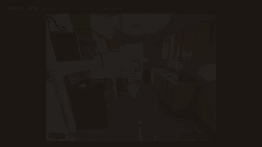
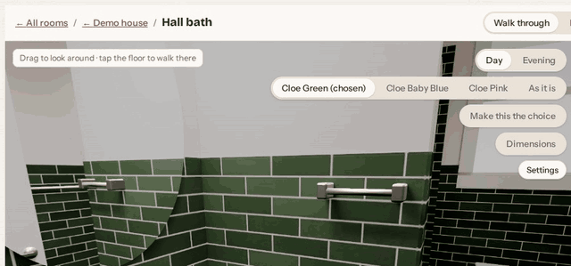
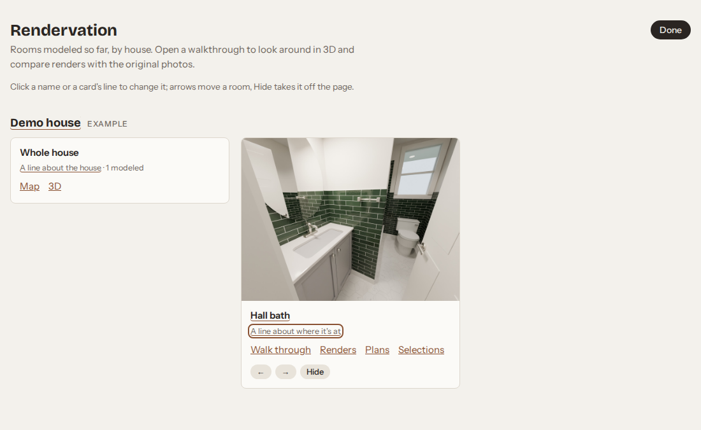
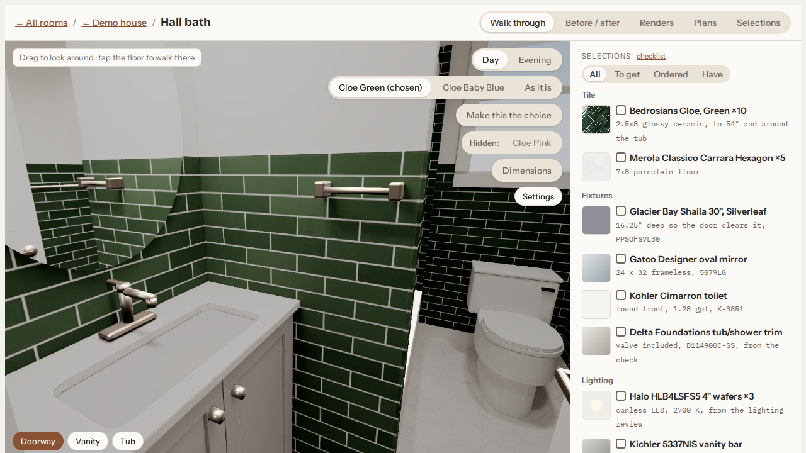
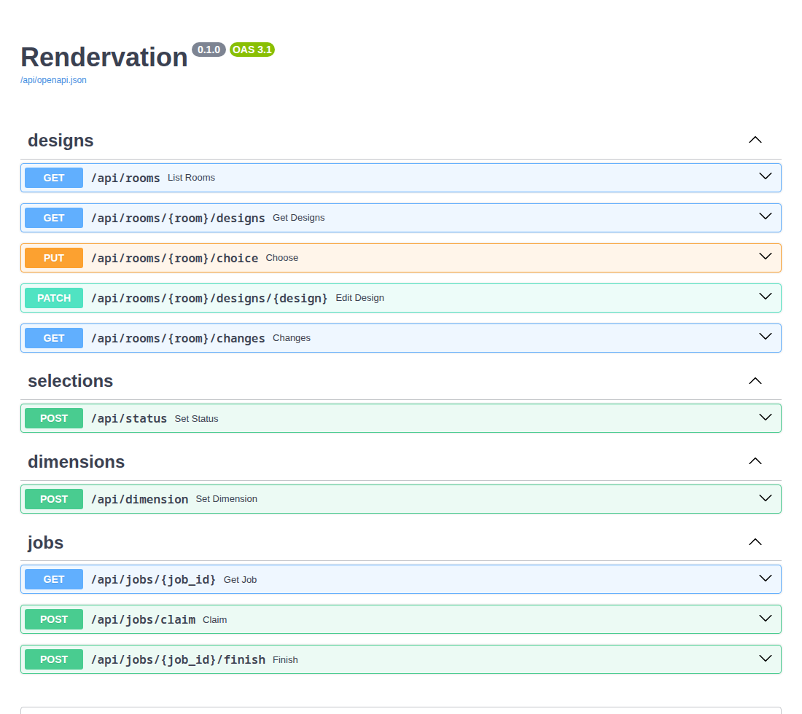

# Rendervation

**Render your renovation before you start it.**

Photoreal 3D models of rooms, before and after a remodel, with a walkthrough you can open in the
browser. One room at a time, in any house.

**Claude Code runs this project.** You talk; Claude does the modeling, rendering and
bookkeeping. Send it photos, measurements, product links and ideas, and it builds the room in
Blender, renders options side by side, and records every choice. You don't need to run any of
the scripts yourself.

[](docs/demo.mp4)

*How a room goes ([full video](docs/demo.mp4)). The terminal part is illustrated, cut down to
the requests that matter: one public-domain photo, then plain asks for real products, a
lighting review and a check. The renders and the website after it are the real output, the
example room in `examples/demo-house/rooms/hall-bath/`: start the server (below), open
http://127.0.0.1:8000 and choose **Example**.*

## Getting started

1. Install [Claude Code](https://claude.com/claude-code),
   [Blender](https://www.blender.org/download/) (4.2 or newer, in its default location) and
   [Podman](https://podman.io/docs/installation) (the web server runs in a container; on Fedora it's
   already there). You also need Python 3 and Git. On Windows, use WSL or Git Bash.
2. Clone this repo (`git clone https://github.com/Jrlaw/Rendervation.git`), open a terminal in
   the `Rendervation` folder, and run `claude`.
3. Say **"set me up"**. Claude checks that Blender renders (and on which GPU), then creates a
   private `houses/` folder for your rooms. It's its own repo, so your photos and renders never
   go into this shared one.
4. Say **"new room: &lt;house&gt;, &lt;room&gt;"** (for example "new room: ours, kitchen"). Claude
   gives you a short list of photos to take and things to measure.

## Viewing your rooms

Everything you look at is a web page served from your own computer. Ask Claude to "show me the
walkthrough" and it starts the server and gives you the link. To start it yourself, run this in the
`Rendervation` folder and leave it running:

```sh
lib/serve.sh
```

The first start builds the server's container (a minute or two); after that it's up in seconds.
Each house's whole-house map and its picture on the home page are rebuilt by themselves whenever a room
is added or changed. The pictures need Playwright's Chromium once per computer:

```sh
python3 -m venv ~/.cache/home-render/pw-venv
~/.cache/home-render/pw-venv/bin/pip install playwright pillow
~/.cache/home-render/pw-venv/bin/playwright install chromium
```

Then open **http://127.0.0.1:8000** on this computer, or **http://&lt;computer name&gt;.local:8000**
from a phone or laptop on the same home network (`hostname` prints the name). Ctrl+C stops it.

- **Home:** every house and room, each card showing the room's chosen design, with links to its
  walkthrough, renders, plans and selections. New rooms appear by themselves.
- **Walkthrough:** walk around the room in 3D. Switch day and evening, flip between designs,
  look at the before photos, and fix a measurement (Claude re-exports the room for you). The
  Settings button adjusts resolution, antialiasing, brightness and field of view for your machine.
- **Plans:** a top-down view with every dimension and where it came from.
- **Selections:** a checklist of the room's products: have, ordered or still to get (click to change; the server
  saves it), with pictures, prices and specs, and a Show in 3D button. The walkthrough's sidebar lists the same
  products for the design on show and outlines one in the room when you click it. The design notes, per design
  option, sit below; the full log stays in `selections-history.md`.

## Changing things on the web

[](docs/server-hide.mp4)

*Hiding a design and bringing it back ([video](docs/server-hide.mp4)).*



- **Edit (home page):** rename a house or room, change the line on its card, move rooms with the
  arrows, and hide one. Hidden rooms are listed under their house to bring back; nothing is deleted.
- **Make this the choice:** under the design pills in the walkthrough. Every tab then opens on that
  design, and the home page shows its picture.
- **Hide:** next to it. The design leaves the walkthrough, Before / after, Renders and Plans; its files
  stay. Hidden designs are listed under **Hidden:**, and clicking one brings it back. The room's own
  design (As it is) and the chosen one can't be hidden.
- **Sizes and products:** fix a measurement in the walkthrough (the worker rebuilds the model, then
  bakes its lighting again in the background), and tick products off in Selections.



These are kept in a small database on your computer (`data/home-render.db`), with a log of every change.
After every edit the worker backs it up into `houses/backup/home-render.json`, so keeping a copy of
`houses/` (another disk, the NAS, cloud storage) keeps your choices too; `python3 lib/tools/db_backup.py --restore`
brings them back. If `houses/` is a git repo with a remote, the backup is also committed and pushed. You can also open a room's `web/index.html` straight from the folder;
it shows the room, but changing things needs the server.

There's no sign-in, so keep the server on your home network, not the internet.

## The server (for developers)

FastAPI in a Podman container, SQLite, and a worker on your computer that runs Blender for it.
[docs/backend.md](docs/backend.md) has the layout and how to add a feature; every endpoint is listed,
and can be tried, at **http://127.0.0.1:8000/api/docs**.



Run the tests before changing anything, and after:

```sh
server/test.sh                         # unit and integration tests, in the container (~1 s)
git config core.hooksPath .githooks    # once per clone: run them before every commit
```

With the hook on, a commit with failing tests stops. GitHub runs the same tests on every pull request.

## Talking to it

- **Photos, measurements, a floor plan:** drop them in. Claude models the room as it is today
  and checks the model against your photos before designing anything.
- **Ideas and products:** paste a link or describe it ("what would sage paint look like?").
  Claude logs it in the room's selections list, models it, and renders it next to the other
  options.
- **Decisions:** "go with the blue tile." Claude makes it the default and keeps the passed-on
  options with the reason.
- **"continue &lt;room&gt;":** where the room stopped and what's next.
- **"status":** every room and its next step.
- **"show me the walkthrough":** Claude starts the viewer and gives you the link (see
  above).

## Experts on call

Three helper agents ship with the project (`.claude/agents/`). Claude runs them in the
background and comes back with what they found; they read and search, and never change the
room themselves. You decide what to adopt, and Claude logs it in `selections.md` and models it.

- **Trades** (`trades`): a tradesperson who reviews the room from their trade's point of view:
  a lighting designer, electrician, cabinet designer, plumber, tile setter, general contractor
  or interior designer. It looks at the model, the dimensions and the renders, and comes back
  with fixes ranked must / should / nice to have (with exact positions), real products for
  anything it suggests adding, and what to measure first.
- **Designer** (`designer`): finds real products that suit your style, wants and budget, and
  checks each one fits the space (width, door swings, clearances). Usually three picks: a best
  match, a budget pick and a splurge, each with a link, price and spec sheet.
- **Checker** (`checker`): walks the model like a site lead before the client sees it. It
  finds what's missing for the room type (a tub with no faucet or shower head, no paper
  holder), what's built wrong (tile across a window, a vanity in the door opening, a fixture
  inside a wall), and anything chosen in `selections.md` that isn't modeled. Claude also runs
  its geometry check on its own after every change to the room.

**How to call them:** just ask, in plain words.

- *"Have a lighting designer review the hall bath."* (The example's cans, vanity bar and fan
  came from exactly this; see its `selections.md`.)
- *"Spawn an agent who is a cabinet designer and have them review our renderings and cabinet
  models for placement and usability in where they're located."*
- *"Get the designer to find a vanity: warm wood, modern, under $800."*
- *"Ask a plumber whether the toilet can move 6 inches."*
- *"Check the hall bath. Is anything missing?"* (On the example, the checker found the tub
  had no faucet or shower head, the tile ran behind the window, and the vanity was deep
  enough to block the door. All three are fixed now; see its `selections.md`.)

**When Claude offers one:** at natural checkpoints, and you can say no. After the room as it
is checks out against your photos (a contractor or designer, for what's worth changing); when
a part of the design settles (the matching trade: cabinets → cabinet designer, lights →
lighting designer); when a selection is still open (the designer); before the final renders
and the walkthrough bake (the checker); and once before a session stops, if the design changed.

In Claude Code, `/agents` lists them, and you can name one directly: *"use the trades agent as
an electrician on the kitchen."*

## Tips

- **Ask for an expert review** whenever a part of the room settles (see "Experts on call"
  above). Each trade catches different things: clearances, door swings, where the light falls,
  outlets and code.
- **Tape-measure what matters first.** A model built from photos is close but not exact. Before
  ordering anything, measure the sizes the design depends on (the walkthrough's Dimensions
  button shows which ones are guesses), type them into the walkthrough, and Claude rebuilds the room.
- **One question at a time.** "What would a darker grout look like?" gets a quick side-by-side.
  Many small asks are better than one big rewrite.
- **Send product links, not names.** Claude saves the photo and the spec sheet, so the model uses
  the real dimensions and the link still means something later.
- **Stop anywhere.** Say "let's stop here" and Claude writes down where the room stands and the
  next step; "continue &lt;room&gt;" picks it back up in a new session.

## Ideas to build on

- **More trades.** The `trades` agent covers seven trades from one checklist; a trade used
  often (say, kitchen cabinets) could get its own agent with a deeper checklist.
- **A whole-house walkthrough** once two connected rooms are modeled (see `PROCESS.md`, Houses).

## How it works

Claude follows [PROCESS.md](PROCESS.md) (start → intake → model the room as it is → ideas and
selections → renders and walkthrough → save), with the `room` skill in `.claude/skills/room/`.
For the curious:

- `houses/<house>/rooms/<room>/`: one room. Photos and notes (`intake/`), every product and
  idea (`selections.md`), the model (`layout.py`, `room.py`), renders, and the walkthrough
  (`web/`).
- `houses/catalog/`: your own products and colors (a particular vanity, a tile color measured
  from a product photo), shared by all your rooms.
- `template/`: what a new room, house or catalog starts from.
- `lib/`: shared by every room, and the same for everyone. `roomkit/` has the Blender building
  blocks, `web/` the walkthrough viewer, `tools/` small helpers, and `render.sh` finds Blender
  and the GPU. Nothing about your own rooms goes in here; improvements come back as PRs.
- `examples/`: the example house, with its own `catalog/`.

## License

The toolkit (code and docs) is [MIT](LICENSE). Your `houses/` folder is yours and isn't part of
it. In the example room, the before photo is public domain (NPS), and the product photos in
`intake/products/` belong to their makers and are included for reference only.
