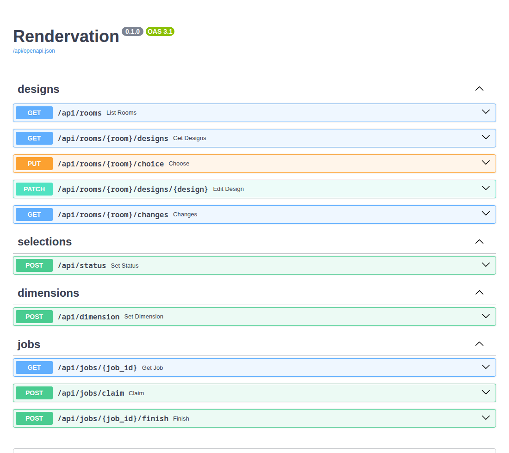

# The server

FastAPI in a Podman container, SQLite for what's changed on the web, and a worker on this computer for
the jobs that need Blender. Start both with `lib/serve.sh`.



## What lives where

**Files (the houses repo, in git)** are what a room *has*: `room.py` and the model, renders, photos, the
baked walkthrough, and each page's own list of designs and cameras (`Walkthrough.start({...})` in
`web/index.html`). Blender makes them, and git keeps their history.

**The database (`data/home-render.db`, not in git)** holds what people change on the web, on top of the
files:

| Table | What |
|---|---|
| `rooms` | each room's chosen design |
| `design_settings` | a design's hidden flag, new label or new place (only where changed) |
| `changes` | every edit: when, who, which room, what (`GET /api/rooms/{room}/changes`) |
| `jobs` | Blender work queued for the worker: `export` (seconds) and `bake` (~8 min) |

A design that's hidden keeps its files; showing it again brings it straight back. The first design (the
room's own export, As it is where there is one) stays first and can't be hidden, and the chosen one
can't be hidden until another is chosen.

Two things still write files, because Blender and the pages read them: a corrected size goes into the
room's `dimensions.json` (the model's input), and a product's status into `inventory.json` (which
rebuilds the Selections page). The status moves into the database next.

## Layout

```
server/
  app.py           create_app(): settings, database, worker token, each feature's router, the pages
  config.py        HR_ROOT, HR_DB, HR_TOOLS from the environment
  db.py            the tables
  deps.py          get_settings, get_db, current_user (one local user until sign-in is added)
  rooms.py         rooms on disk, their designs with the database's edits on top
  features/        one module per feature, each with its own APIRouter, listed in FEATURES:
    designs.py       list, choose, hide / show, rename, reorder; makes home-page cards
    inventory.py     product status (the Selections checklist)
    dimensions.py    corrected sizes → an export job
    jobs.py          the queue the worker takes jobs from
  tests/           pytest: unit (test_rooms) and integration (test_api, test_worker), on a test house
  Containerfile    python:3.13-slim; the `test` stage adds pytest
lib/worker.py      the worker: standard library only, runs next to Blender
lib/serve.sh       builds the image if needed, starts the worker and the container
server/test.sh     the tests, in the container
```

To add something people can edit on the web: a new module in `server/features/` with its router and
Pydantic models, any new table in `db.py`, a line in `FEATURES`, and tests in `server/tests/`. Every
edit goes through `current_user` and adds a `Change`, so adding sign-in later means changing
`current_user` only.

## Pages

Pages are the repo's own files, served as they are: `index.html`, `houses/`, `examples/`, `lib/web/`
and `template/`. Nothing else is served: not `data/`, not the code, not dot-folders like `.git` or a
room's `web/.bake`. Every file is sent in full (no "not modified"): a renders link re-pointed at an
older folder serves an older file at the same address, and browsers would keep the old picture.

The walkthrough and Plans ask `GET /api/rooms/{room}/designs` for the room's designs and chosen one;
opened straight from disk they fall back to the page's own list. The houses page asks `GET /api/rooms`
for each room's card picture (`lib/web/cards.js`).

## The worker

The container has no Blender or GPU, so a size typed into the walkthrough queues an `export` job, and
`lib/worker.py` (started by `lib/serve.sh`) claims it, runs the room's `render.sh --export web`, and
reports back. A finished export queues a `bake`. Exports and bakes run in separate lanes, so a quick
export never waits behind a bake. The worker's calls carry the token the server writes to
`data/worker.token` on each start. With the worker stopped, jobs wait and the page says so.

## Network

`lib/serve.sh` publishes port 8000 on the home network: `http://<this computer>.local:8000`. There's
no sign-in, so keep it off the internet. Hosting it on the NAS later means running the same image
there, with renders sent over after each run and the worker staying on this computer.

## Tests

`server/test.sh` runs every test in the container, in about a second. The git hook
(`.githooks/pre-commit`) runs it before each commit and stops the commit if anything fails, and
GitHub runs the same tests on every pull request (`.github/workflows/server-tests.yml`).

## Back up

`data/home-render.db` is the only copy of the choices, hidden designs and the change log. Copy it while
the server is stopped, or any time with `sqlite3 data/home-render.db ".backup data/backup.db"`.
