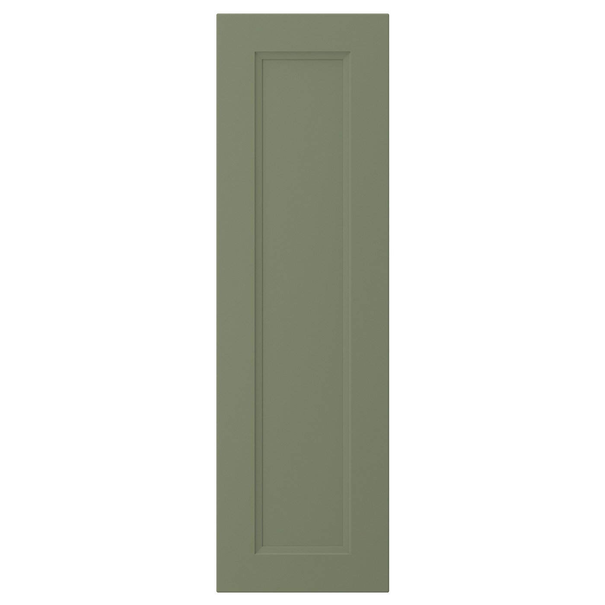
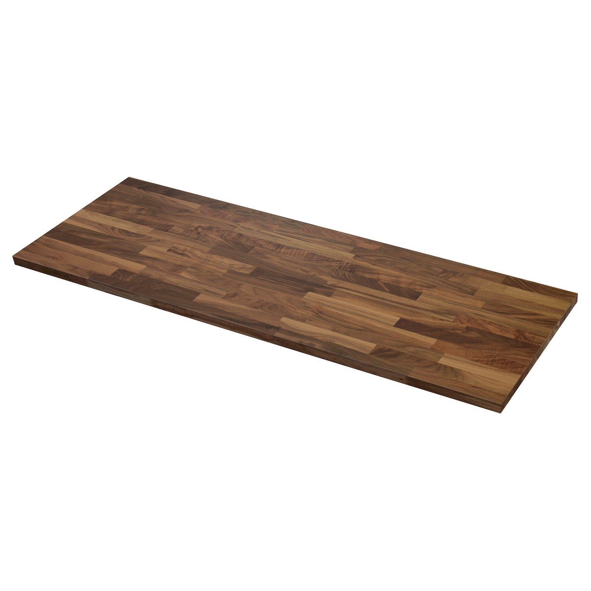
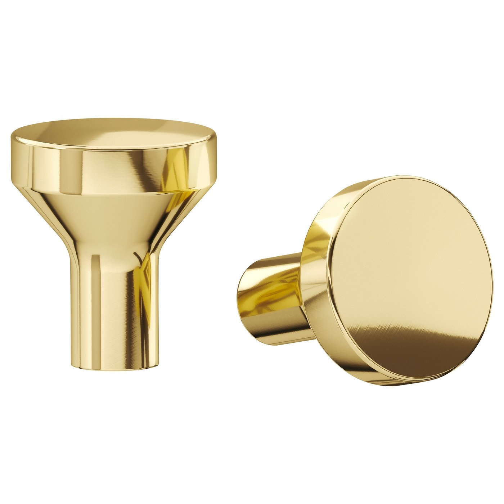

# Selections: Kitchen

What's current for this room: chosen, ordered, open and existing. Passed-on options and how we
got here are in `selections-history.md`. Updated whenever a link is shared, an option is
rendered, or something is picked.

Status: **idea** (suggested, nobody's looked yet) · **considering** (options on the table) ·
**chosen** · **ordered** · **installed** · **existing** (already there, staying).
Prices as seen on 2026-11-11.

This is an example room. The before photos are public domain (National Park Service, see
`intake/README.md`); the new design is ours, not the remodel the park service did.

## Open decisions

- Sink: one store lists the Kraus KHT300-33 as discontinued. Check stock, or pick another 33"
  single-bowl drop-in that fits a 36" base.
- Room size: read off the photos. Tape the room and the window over the sink before ordering
  cabinets. Also tape: the existing microwave's height and model (the cabinet over it assumes a
  16 1/2" GE that can drop 1 1/2"), the north wall to the living room door's casing (124" needed),
  and the soffits' depth and bottom (they get furred out to 15 1/2").
- Chairs for the table: three, wood or upholstered (not black). Not picked.
- Nice to have, not modeled: an olive and charcoal runner down the aisle (Loloi II Layla LAY-03,
  2'6" x 7'6", about $43) and a cellular blind on the sink window (IKEA HOPPVALS, white, 30", $34.99,
  once the window is taped).

---

## Cabinets

**Status:** chosen

- **IKEA SEKTION cabinets with AXSTAD doors and drawer fronts, gray-green.** IKEA, $89 for a
  15 x 30" door.
  - Link: https://www.ikea.com/us/en/p/axstad-door-gray-green-50563931/
  - Specs: 14 7/8 x 29 7/8 x 3/4" for a 15 x 30" box, painted shaker. SEKTION bases are 30"
    boxes on 4 1/2" legs.
  - Sink wall, north to south: 12" drawer base, 24" dishwasher opening, 36" sink base, 18"
    three-drawer, 15" drawer base. Range wall: 24" three-drawer and 36" two-door base.
  - Wall cabinets 30" high under the soffits, 15" deep (US SEKTION), with the soffits furred out
    to 15 1/2" to meet them. 30 x 15" over the fridge (24" deep) and over the microwave.
  - **Over the microwave:** SEKTION wall cabinet, horizontal, white/AXSTAD gray-green, 30x15x15", about
    $192. Its bottom lines up with the fridge cabinet's at 69", so the microwave drops 1 1/2" (top 69";
    GE wants the top at least 66" up). Back its bottom with 1/2" plywood for the microwave's bolts; the
    microwave's outlet moves inside it. A drywall box above carries the soffit across.
    https://www.ikea.com/us/en/p/sektion-wall-cabinet-horizontal-white-axstad-gray-green-s99516599
  - Fillers: 1 1/2" at the north wall on the sink run (the upper's door clears the wall), 2 1/2" on the
    range wall (the range and microwave move 1/2" north, clear of the living room door's casing), upper
    fillers matching. The 12" base at the north end is a full-height pull-out (no 12" drawer base in the US).
  - Open ends: AXSTAD cover panels, 25x30" at the sink run's south end ($56,
    https://www.ikea.com/us/en/p/axstad-cover-panel-gray-green-80563915), 15x32 1/2" cut to 30 on the
    upper beside it ($37), and 25x90" cut to 84 on the fridge's south side ($167,
    https://www.ikea.com/us/en/p/axstad-cover-panel-gray-green-40563917).
  - Knobs centered on the door stiles, 3" from the end; the lift-up doors get one centered 1 1/2" up.
  - Saved: `intake/products/ikea-axstad-gray-green.jpg`

## Counters

**Status:** chosen

- **IKEA KARLBY countertop, walnut veneer.** IKEA, $279 each.
  - Link: https://www.ikea.com/us/en/p/karlby-countertop-walnut-veneer-50335208/
  - Specs: 74 x 25 5/8 x 1 1/2".
  - Amount: 3 (106" on the sink wall in two pieces, 63" on the range wall), about $840.
  - Texture: `textures/karlby_walnut.jpg` (rectified from the IKEA photo).
  - Saved: `intake/products/ikea-karlby-walnut.jpg`

## Hardware

**Status:** chosen

- **IKEA BAGGANÄS knob, brass color.** IKEA, $8 on the listing (check the pack count).
  - Link: https://www.ikea.com/us/en/p/bagganaes-knob-brass-color-00338412/
  - Specs: 13/16" diameter.
  - Saved: `intake/products/ikea-bagganas-brass.jpg`

## Back splash

**Status:** chosen

- **Bedrosians Cloé 2.5 x 8" glossy ceramic, White.** About $7.70/sq ft ($81.97 for a 10.64 sq ft
  carton).
  - Link: https://superarbor.io/products/1000503951-bedrosians-cloe-76-pack-white-2-1-2-in-x-8-in-glossy-ceramic-subway-wall-tile
  - Amount: about 22 sq ft from the counters to the wall cabinets and behind the range, so 3
    cartons with waste (about $250).

## Sink and faucet

**Status:** chosen (sink: check stock)

- **Kraus Standart PRO KHT300-33, stainless, drop-in single bowl.** Kraus, $369.
  - Link: https://www.kraususa.com/kraus-kht300-33-33-drop-in-16-gauge-stainless-steel-single-bowl-kitchen-sink.html
  - Specs: 33 x 22 x 10 5/8"; bowl 31 x 18 x 10"; needs a 36" base.
- **Delta Essa 9113-AR-DST pull-down, Arctic stainless.**
  - Link: https://ferguson.com/product/delta-faucet-essa-d9113ardst/5152693.html
  - Specs: 15 3/4" high, 9 3/8" reach, one hole.

## Appliances

**Status:** chosen (range and microwave existing)

- **GE GTS19KYNRFS top-freezer refrigerator, fingerprint-resistant stainless.**
  - Link: https://www.geappliances.com/appliance/GE-19-2-Cu-Ft-Garage-Ready-Top-Freezer-Refrigerator-GTS19KYNRFS
  - Specs: 66 3/8 x 29 3/4 x 34 1/2" (H x W x D); 32 3/8" wide with the door open 90°, so the doors
    are reversed to hinge on the south side, away from the north wall.
- **Bosch 100 Series SHE3AEM5N dishwasher, stainless.**
  - Link: https://media3.bosch-home.com/Documents/specsheet/en-US/SHE3AEM5N.pdf (spec sheet)
  - Specs: 33 7/8 x 23 9/16 x 22 9/16", for a 24" opening.
- **Range and over-the-range microwave:** existing, staying.

## Lights

**Status:** chosen

- **Halo HLB4LSFS5 4" canless LED wafers**, 2700 K, as in the hall bath. Three down the aisle, on
  their own dimmer.
  - Link: https://www.cooperlighting.com/global/brands/halo/12015789/hlb-slim-low-glare-canless-led-downlights/hlb4lsfs5

- **IKEA MITTLED LED countertop strip, dimmable white, 24"** (004.554.20), $30 each, ×4: two under
  the range wall's uppers, one under each sink-run upper, on a TRÅDFRI driver ($45) and dimmer. The
  driver needs an outlet in a cabinet or hardwiring (electrician).
  https://www.ikea.com/us/en/p/mittled-led-kitchen-cntrtp-lighting-strip-dimmable-white-00455420
- **Rejuvenation Butte 18" dome pendant, aged brass**, $449, over the table on its own dimmer, its
  bottom 32" over the top. https://rejuvenation.com/products/butte-dome-pendant-18in-aged-brass

## Eat-in end

**Status:** chosen (chairs open)

- **IKEA DOCKSTA table, 40 1/2" round, white/white**, $279.99, against the east wall under the
  window (seats three, leaves 72" to the range wall).
  https://www.ikea.com/us/en/p/docksta-table-white-white-s19324995

## Walls and floor

**Status:** chosen (floor existing)

- **Paint:** Sherwin-Williams Alabaster SW 7008, walls and soffits (the soffits read as wall), in
  place of the green.
- **Floor:** the existing vinyl plank stays.
